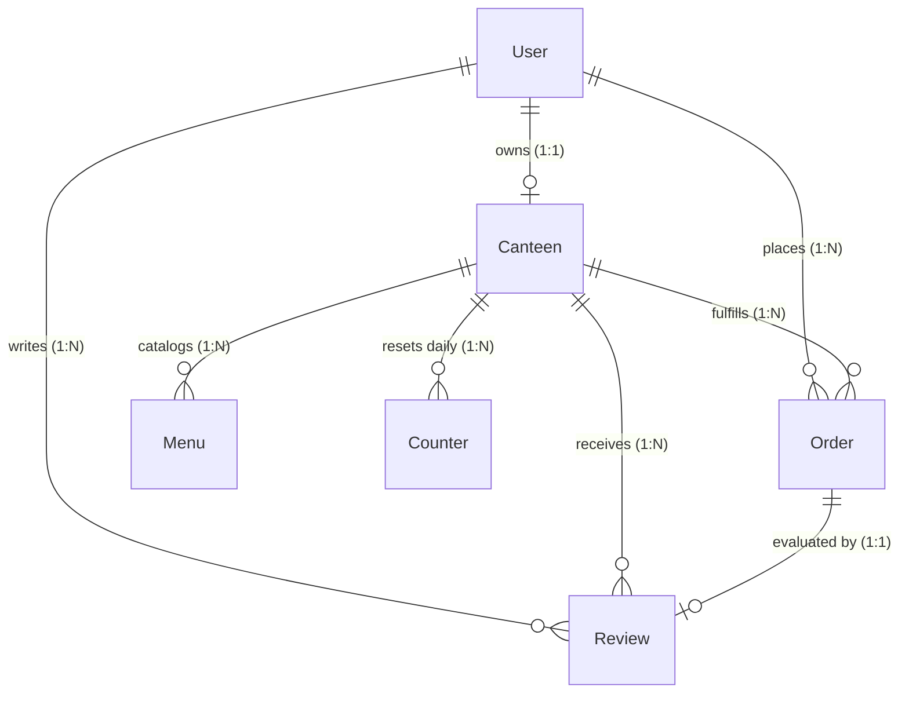

# Implementation Details — Rush Bites

This document details the concrete implementation, schema design, API specifications, and frontend component architecture of the Rush Bites platform.

---

## 1. Database Schema & Data Dictionary

The persistence layer is modeled in MongoDB using Mongoose 9 with strict validation, default values, and compound indexes.



### 1.1. User Schema (`user.model.js`)
Tracks user authentication identity synced from Clerk, role permissions, and profile metadata:
- `clerkId` (String, required, unique, indexed): Primary identifier from Clerk authentication.
- `name` (String, required, min: 2, max: 50): Customer or vendor display name.
- `email` (String, required, unique, lowercase): Contact email.
- `role` (String, enum: `["customer", "staff", "admin"]`, default: `"customer"`).
- `profileImage` (String): Avatar URL synced from OAuth/Clerk.
- Timestamps: `createdAt`, `updatedAt`.

### 1.2. Canteen Schema (`canteen.model.js`)
Represents an individual food counter, kitchen stall, or cafeteria vendor:
- `name` (String, required, max: 80): Canteen display name.
- `owner` (ObjectId, ref: `User`, required, unique): The single vendor user who manages this canteen.
- `description` (String, max: 300): Cuisine type or tagline.
- `location` (String, max: 120): Physical counter location (e.g., "Hall B, Counter 2").
- `contactName` (String, max: 80) & `contactPhone` (String, max: 10): Operator details.
- `upiId` (String, max: 320): Vendor UPI VPA (e.g., `canteen@upi`) for intent deep links.
- `qrImageUrl` (String, max: 300,000): Static uploaded UPI QR image fallback.
- `photo` (String, max: 300,000): Canteen storefront photograph.
- `hours`: Sub-document containing `open` (HH:MM) and `close` (HH:MM).
- `isOpen` (Boolean, default: `true`): Live operational toggle; when false, orders are blocked.
- `ratingAvg` (Number, default: 0) & `ratingCount` (Number, default: 0): Denormalized review aggregates.

### 1.3. Menu Item Schema (`menu.model.js`)
Individual food and beverage offerings tied to a specific canteen:
- `canteen` (ObjectId, ref: `Canteen`, required, indexed).
- `name` (String, required, min: 2, max: 100).
- `description` (String, max: 500).
- `price` (Number, required, min: 0): Unit price in INR (₹).
- `isVeg` (Boolean, default: `true`): FSSAI-style green/brown dietary indicator.
- `category` (String, required): Grouping label (e.g., "Snacks", "Lunch", "Beverages").
- `image` (String, max: 300,000): Image CDN URL.
- `prepMins` (Number, default: 10, min: 0, max: 120): Estimated kitchen cooking time.
- `isAvailable` (Boolean, default: `true`): Stock availability toggle.

### 1.4. Order Schema (`order.model.js`)
Central transaction document capturing order lifecycle, payment, and items:
- `customer` (ObjectId, ref: `User`, required, indexed).
- `canteen` (ObjectId, ref: `Canteen`, required, indexed).
- `items`: Array of line item subdocuments:
  - `menuItem` (ObjectId, ref: `Menu`), `name`, `price`, `quantity`, `prepMins`, `isVeg`.
- `totalAmount` (Number, required, min: 0): Total order value in INR.
- `tokenNumber` (Number, required): Per-day sequential counter token (`#1, #2...`).
- `status` (String, enum: `["pending", "accepted", "preparing", "ready", "completed", "cancelled"]`, default: `"pending"`, indexed).
- `payment`:
  - `method` (`"cash"` | `"upi_qr"`).
  - `state` (`"pending"` | `"submitted"` | `"confirmed"` | `"failed"`).
  - `reference` (String): Customer-submitted UPI UTR transaction reference number.
  - `confirmedAt` (Date) & `confirmedBy` (ObjectId, ref: `User`).
- `note` (String, max: 200): Special customer instructions (e.g., "Extra spicy").
- `pickupAt` (Date): Estimated or requested meal collection time.

### 1.5. Counter Schema (`counter.model.js`)
Enforces atomic sequential daily token numbers per canteen:
- `canteen` (ObjectId, ref: `Canteen`, required).
- `day` (Date, required): Normalized to midnight UTC (`dayStart`).
- `seq` (Number, default: 0): Atomic increment integer.
- Compound unique index: `{ canteen: 1, day: 1 }`.

### 1.6. Review Schema (`review.model.js`)
Verified customer ratings for completed orders:
- `order` (ObjectId, ref: `Order`, required, unique): Exactly one review per order.
- `canteen` (ObjectId, ref: `Canteen`, required, indexed).
- `customer` (ObjectId, ref: `User`, required).
- `rating` (Number, required, min: 1, max: 5): Whole star rating.
- `comment` (String, max: 500): Qualitative feedback.

---

## 2. API Endpoint Architecture

### 2.1. Authentication Routes (`/api/auth`)
- `GET /api/auth/me`: Validates session token and returns active Clerk identity.
- `POST /api/auth/sync`: Syncs the Clerk profile into MongoDB; returns the updated user document.

### 2.2. Canteen Routes (`/api/canteens`)
- `POST /api/canteens`: Registers a new canteen for the authenticated user and elevates their role to `"staff"`.
- `GET /api/canteens/mine`: Fetches the caller's owned canteen including live menu item count.
- `PUT /api/canteens/mine`: Updates details, opening hours, UPI configuration, and `isOpen` status.
- `GET /api/canteens`: Public marketplace listing of all open canteens with live queue length and rating stats.
- `GET /api/canteens/:id`: Public canteen profile with real-time queue length.

> [!IMPORTANT]
> The route definitions in `canteen.routes.js` explicitly place `/mine` **before** `/:id` to prevent Express from capturing the literal string `"mine"` as an `:id` parameter.

### 2.3. Menu Routes (`/api/menu`)
- `GET /api/menu`: Public menu feed across all open canteens. Accepts optional `?canteen=<id>` and `?category=<name>`.
- `POST /api/menu`: Creates a dish scoped to the vendor's canteen.
- `PUT /api/menu/:id`: Edits item details, price, prep time, or toggles `isAvailable`.
- `DELETE /api/menu/:id`: Permanently deletes an item from the vendor's catalog.
- `PATCH /api/menu/availability`: Bulk toggle marking all dishes available or sold out in one click.

### 2.4. Order Routes (`/api/orders`)
- `POST /api/orders`: Validates cart, ensures single-canteen constraint, reserves atomic daily token, and creates order.
- `GET /api/orders`: Customer order history populated with canteen names and live queue-ahead estimations.
- `PATCH /api/orders/:id/cancel`: Customer cancellation of unfulfilled, unpaid cash orders.
- `POST /api/orders/:id/payment`: Customer submits 6+ character UTR payment reference for UPI orders.
- `GET /api/orders/vendor/queue`: Vendor order queue with query filters (`?active=1` or `?unpaid=1`).
- `GET /api/orders/vendor/stats`: Vendor daily dashboard analytics (orders, revenue, pending cash debt, top dishes).
- `PATCH /api/orders/vendor/:id/status`: Vendor lifecycle advancement (`accepted`, `preparing`, `ready`, `completed`, `cancelled`).
- `PATCH /api/orders/vendor/:id/payment`: Vendor confirms or rejects payment outcome (`confirmed` | `failed`).

### 2.5. Review Routes (`/api/reviews`)
- `POST /api/reviews`: Submits a 1–5 star rating for a completed order and recalculates the canteen's rating average.
- `GET /api/reviews/canteen/:id`: Fetches recent customer reviews for a canteen.

### 2.6. Upload Routes (`/api/uploads`)
- `POST /api/uploads`: Uploads base64 image data to Cloudinary (`rush-bites/menu-items` or `rush-bites/canteens`), applies 1200px limit, and returns an HTTPS CDN URL.

---

## 3. Frontend Component Hierarchy & State Architecture

```
App.jsx (ClerkProvider, ToastProvider, ConnectionBanner)
 └── SignedIn
      ├── ProfileProvider (MongoDB User Sync & Role State)
      │    └── CanteenProvider (Vendor Canteen Document, Registration, Settings)
      │         └── CartProvider (Cart Items, Quantities, Single-Vendor Guard)
      │              ├── TopBar (Brand lockup, Date, Cart trigger, UserButton, ThemeToggle)
      │              ├── VendorPing (Background order polling & Web Audio chime)
      │              ├── Shell
      │              │    ├── Tabs: Menu | Orders | Canteens [| My Menu | My Canteen]
      │              │    ├── View: MenuPage (Search, Categories, Product Cards)
      │              │    ├── View: OrdersPage (Active Orders, Status Tracking, Reorder, Reviews)
      │              │    ├── View: CanteensPage (Canteen Cards, Queue Chips, Reviews Drawer)
      │              │    ├── View: MenuManager (Dish Form, Category Groups, Stock Toggles)
      │              │    └── View: VendorDashboard (Checklist, Settings, Queue, Stats, Counter Mode)
      │              └── CartDrawer (Quantity Stepper, Pickup Selector, PayModal Trigger)
```

### 3.1. Role-Adaptive Navigation in `Shell`
The navigation bar dynamically inspects credentials:
```javascript
const isVendor = isStaff || Boolean(canteen);
const tabs = isVendor
    ? [...CUSTOMER_TABS, ...VENDOR_TABS]
    : CUSTOMER_TABS;
```
- Customers only see: `Menu`, `Orders`, and `Canteens`.
- Vendors and Staff seamlessly receive: `My Menu` and `My Canteen`.

### 3.2. Dynamic Amount-Locked UPI Module (`upi.js` & `UpiQr.jsx`)
Constructs validated NPCI URI parameters and renders an SVG QR code:
```javascript
export function buildUpiLink({ upiId, payeeName, amount, note, tr }) {
    if (!upiId) return null;
    const p = new URLSearchParams({
        pa: upiId,
        pn: payeeName || "Rush Bites",
        am: Number(amount).toFixed(2),
        cu: "INR",
        tn: note || "Rush Bites order",
        tr: tr || String(Date.now()),
    });
    return `upi://pay?${p.toString()}`;
}
```

### 3.3. Sound Alert Engine (`sound.js`)
Synthesizes crisp auditory cues without static assets:
```javascript
function tone(freq, start, duration, gain = 0.06) {
    const audio = getCtx();
    const osc = audio.createOscillator();
    const vol = audio.createGain();
    osc.type = "sine";
    osc.frequency.value = freq;
    vol.gain.setValueAtTime(0, audio.currentTime + start);
    vol.gain.linearRampToValueAtTime(gain, audio.currentTime + start + 0.02);
    vol.gain.exponentialRampToValueAtTime(0.0001, audio.currentTime + start + duration);
    osc.connect(vol).connect(audio.destination);
    osc.start(audio.currentTime + start);
    osc.stop(audio.currentTime + start + duration + 0.05);
}
```
