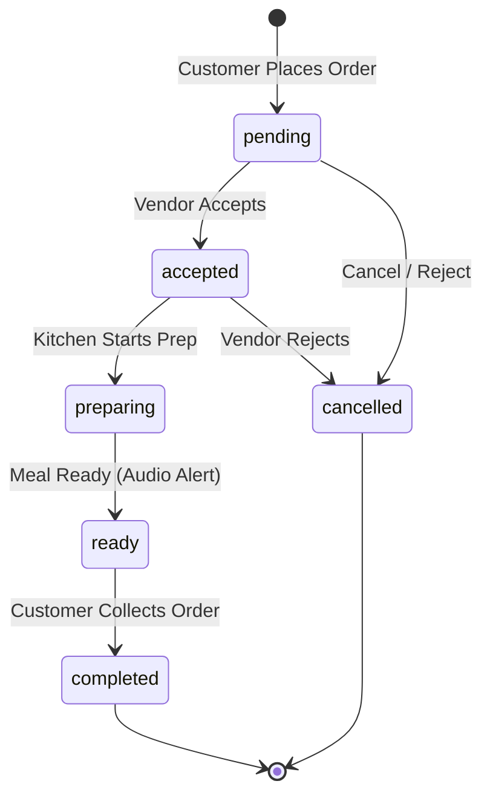

# System Methodology — Rush Bites

## 1. Architectural Philosophy

Rush Bites employs a decoupled, service-oriented architecture designed to operate reliably across constrained campus networks and varied personal devices. The system is split into an interactive Single-Page Application (SPA) frontend and a stateless RESTful backend backed by a distributed NoSQL document store.

```
┌────────────────────────────────────────────────────────┐
│                   Customer & Vendor Clients            │
│       React 19 SPA · Clerk Auth · Web Audio API        │
└───────────────────────────┬────────────────────────────┘
                            │ HTTPS / JSON
                            ▼
┌────────────────────────────────────────────────────────┐
│                    Express 5 API Gateway               │
│  Rate Limiters · Clerk Middleware · Auth & Controllers │
└─────────────┬────────────────────────────┬─────────────┘
              │                            │
              ▼                            ▼
┌──────────────────────────┐  ┌──────────────────────────┐
│     MongoDB Atlas        │  │     Cloudinary CDN       │
│ Users · Canteens · Menus │  │ Canteen Photos, QR Codes │
│ Orders · Counters · Revs │  │     Menu Dish Images     │
└──────────────────────────┘  └──────────────────────────┘
```

---

## 2. Core Operational Workflows

### 2.1. Authentication & Role Elevation
1. **User Sign-In**: The client authenticates via Clerk using Google OAuth or Email One-Time Password (OTP).
2. **Profile Synchronization**: The client invokes `POST /api/auth/sync`. The backend extracts the verified `userId` from the JWT claims, retrieves the profile from the Clerk API, and upserts a matching MongoDB `User` document.
3. **Role-Based Elevation**:
   - Default role upon initial registration is `"customer"`.
   - When a customer registers a canteen via `POST /api/canteens`, their user document is atomically elevated to `"staff"` role.
   - The frontend `ProfileContext` and `CanteenContext` synchronize immediately, activating vendor navigation controls (`My Menu`, `My Canteen`) without requiring re-authentication.

---

### 2.2. Order Lifecycle State Machine

Orders follow a strict unidirectional state machine to preserve operational clarity between customers and canteen kitchens:

| Transition | Permitted From | Next State | Triggered By | Validation Rules |
| :--- | :--- | :--- | :--- | :--- |
| **Accept** | `pending` | `accepted` | Vendor | Canteen owner verification. |
| **Prepare** | `accepted` | `preparing` | Vendor | Kitchen initiates cooking. |
| **Ready** | `preparing` | `ready` | Vendor | Meal is ready for counter collection; fires customer audio chime. |
| **Complete** | `ready` | `completed` | Vendor | Meal collected by customer; enables customer review submission. |
| **Cancel** | `pending`, `accepted` | `cancelled` | Customer / Vendor | Permitted only for unfulfilled cash orders; blocked if payment is settled. |
| **Reject** | `pending`, `accepted` | `cancelled` | Vendor | Rejects order due to stock out or kitchen surge. |



---

### 2.3. Dual Payment Workflow & Reconciliation

The platform guarantees support for both cash-first campus routines and modern digital UPI transactions:

```
[Customer Checkout]
      │
      ├── Method = "cash"
      │       └── Order created with status="pending", payment.state="pending"
      │       └── Cash handed over at counter pickup
      │       └── Vendor clicks "Cash received" → payment.state="confirmed"
      │
      └── Method = "upi_qr"
              └── Order created with status="pending", payment.state="pending"
              └── PayModal renders dynamic amount-locked UPI QR + deep-link
              └── Customer pays via UPI app, inputs 6+ char UTR / Reference
              └── POST /api/orders/:id/payment → payment.state="submitted"
              └── Vendor verifies UTR in queue → Clicks "Confirm" (or "Reject")
              └── payment.state="confirmed"
```

---

## 3. Key Algorithmic & Engineering Solutions

### 3.1. Atomic Daily Token Number Generation
To provide human-readable, sequential numbers that reset every day per canteen (e.g., `#1`, `#2` on Sep 25, then `#1`, `#2` on Sep 26), standard sequential IDs or auto-increments fail in distributed systems.

**Solution**: Rush Bites uses an atomic `Counter` document keyed by `canteen` and `dayStart` (normalized to midnight UTC):
```javascript
const dayStart = new Date();
dayStart.setHours(0, 0, 0, 0);

const counter = await Counter.findOneAndUpdate(
    { canteen: canteen._id, day: dayStart },
    { $inc: { seq: 1 } },
    { returnDocument: "after", upsert: true }
);

const tokenNumber = counter.seq;
```
This guarantees race-condition-free, zero-gap sequential tokens without distributed locks.

---

### 3.2. Dynamic Amount-Locked UPI Deep-Linking
Static counter QR codes fail during rushes because students must type prices manually, creating errors.

**Solution**: Rush Bites dynamically constructs a strict National Payments Corporation of India (NPCI) UPI Intent URI:
$$\text{upi://pay?pa=}\langle\text{UPI\_ID}\rangle\text{\&pn=}\langle\text{NAME}\rangle\text{\&am=}\langle\text{AMOUNT}\rangle\text{\&cu=INR\&tn=}\langle\text{NOTE}\rangle\text{\&tr=}\langle\text{REF}\rangle$$

- Rendered client-side via vector SVG (`react-qr-code`), avoiding network roundtrips to external QR generators.
- On mobile devices, clicking the link directly activates installed payment applications (Google Pay, PhonePe, Paytm, BHIM) with payee and price pre-filled.

---

### 3.3. Live Queue Position & ETA Estimation
When customers view their pending orders, they need to know when to walk to the cafeteria:

$$\text{EstimatedReadyAt} = \text{OrderPlacedTime} + \max_{i \in \text{Items}}(\text{prepMins}_i) + (\text{ActiveOrdersAhead} \times 2\text{ mins})$$

- Active orders ahead are queried directly from the live database using an aggregation pipeline matching `{ canteen, status: { $in: ["pending", "accepted", "preparing"] }, createdAt: { $lt: order.createdAt } }`.
- Both customer and vendor screens compute from the same source of truth, preventing discrepancy between counter calls and app notifications.

---

### 3.4. Single-Vendor Cart Boundary
College canteens operate independent kitchens. An order cannot be split across multiple kitchens simultaneously.

**Solution**:
- The client-side `CartContext` checks incoming dish canteen metadata against the current cart's canteen.
- If a customer attempts to add an item from a second canteen, the system intercepts the action and presents an explicit confirmation modal to clear and switch or cancel.
- The server validates this as a hard invariant (`canteenIds.size === 1`) in `createOrder`.

---

## 4. Security, Resilience & Rate Limiting Strategy

### 4.1. Campus NAT-Safe Rate Limiting
In a university environment, hundreds of students connect to the internet through a shared campus Wi-Fi network with a single public IPv4 NAT. Generic IP-based rate limiting would throttle an entire campus simultaneously.

**Solution**: Dual-tier key generator in `rateLimit.middleware.js`:
- Authenticated requests are bucketed by unique Clerk `userId`: `u:${userId}`.
- Unauthenticated requests fall back to an IPv6/IPv4 subnet mask: `ip:${ipKeyGenerator(req.ip)}`.
- Differential thresholds:
  - **Global Ceiling**: 300 requests / 5 min per user.
  - **Auth Operations**: 30 requests / 5 min per user (protects DB during mass sign-in storms).
  - **Order Placement**: 20 orders / 15 min per user (prevents script-flooding the kitchen).
  - **Media Uploads**: 40 uploads / 15 min per user.

### 4.2. Graceful Degraded Offline & Connection Monitoring
- `ConnectionBanner.jsx` actively samples the `/api/health` heartbeat every 15 seconds.
- Distinguishes between full server offline (`status: 0`) and database disconnection (`status: 503`), rendering a contextual status strip with manual retry capabilities and auto-dismissing toast notifications on reconnection.
- Image uploads quietly fallback from Cloudinary CDN to inline Base64 data URLs if cloud API credentials are temporarily unreachable.
